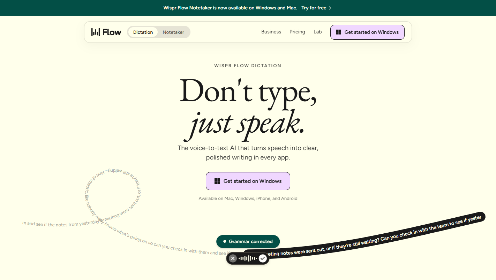
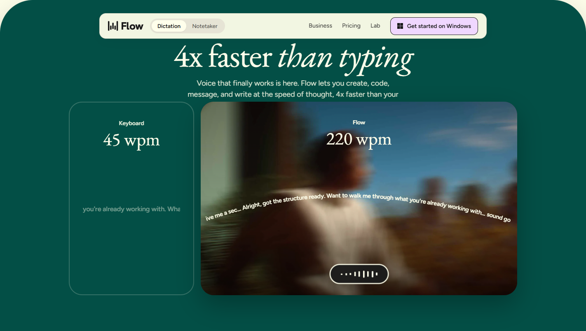
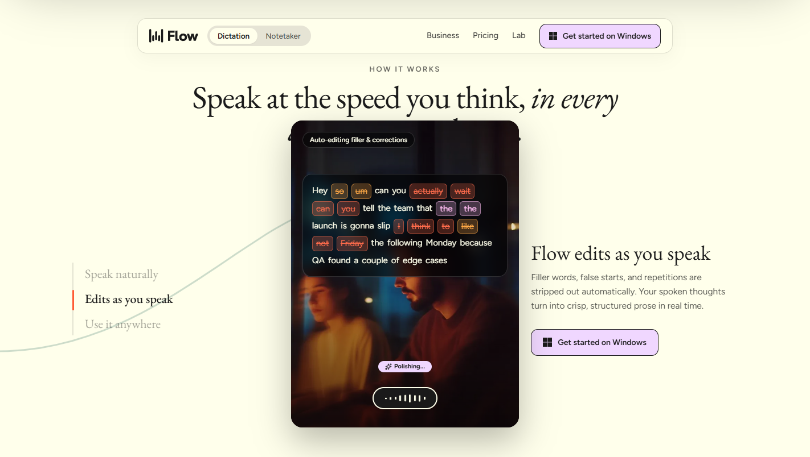
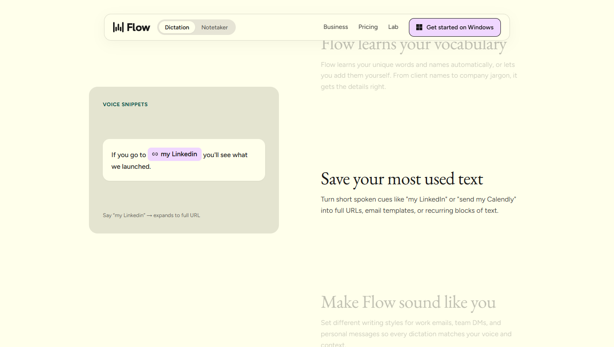
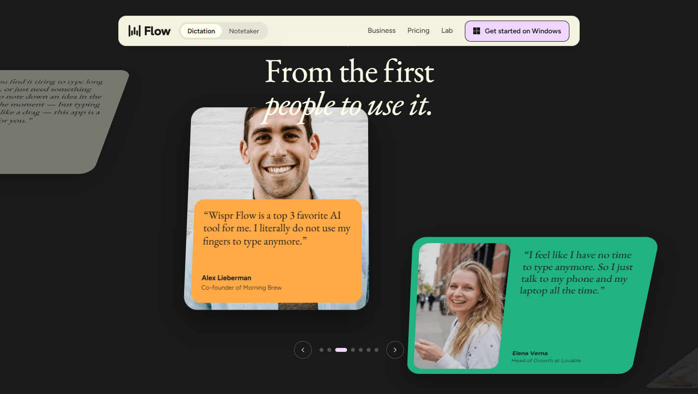
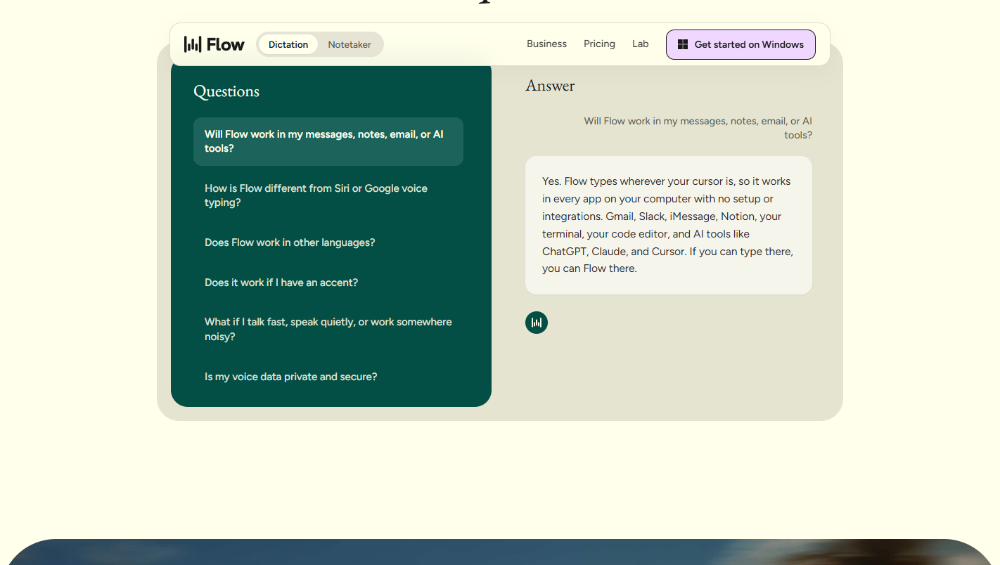

# Wispr Flow Homepage Replica

A clean, idiomatic **Next.js (App Router) + TypeScript + Tailwind CSS + Framer Motion** recreation of the [Wispr Flow](https://wisprflow.ai/) homepage, featuring scroll-scrubbed choreography, 3D perspective card orbits, and interactive voice-to-text UI demos.



---

## 📸 Visual Showcase

### 1. Editorial Hero & Dual-Curve SVG `<textPath>` Stream


### 2. Pinned Speed Comparison (`Keyboard 45 wpm` vs. `Flow 220 wpm`)


### 3. Unified Scroll Morph & 3-Step Interactive Showcase (`How It Works`)


### 4. Sticky 4-Card Feature Stack & Voice Snippets


### 5. 3D Cylindrical Testimonials Orbit Deck


### 6. Two-Pane Conversational FAQ


---

## ✨ Features & Scroll Choreography

1. **Floating Pill Navigation & Wave-Text Hover (`src/components/Navbar.tsx`)**
   - Top announcement banner + sticky frosted-glass pill navbar (`Dictation` / `Notetaker` mode switcher, `Business` hover dropdown, and character-by-character wave hover animations).

2. **Editorial Hero with Dual-Curve SVG `<textPath>` Stream (`src/components/HeroSection.tsx`)**
   - `EB Garamond` editorial typography paired with a continuous `requestAnimationFrame` SVG `<textPath>` loop that streams raw spoken thoughts through a loop-de-loop curve into a central *"Grammar corrected"* transformation badge and exits as polished prose inside a dark ribbon.

3. **Scroll-Reactive Dynamic Corner Radius (`src/hooks/useDynamicCorners.ts`)**
   - Custom React hook that smoothly interpolates section top and bottom border radii (`0px ↔ 80px` on desktop, `0px ↔ 40px` on mobile) based on real-time viewport scroll offset.

4. **Unified Pinned Scroll Morph & 3-Step Showcase (`src/components/HowItWorksSection.tsx`)**
   - A `620vh` pinned scroll stage driven by normalized scroll progress `p ∈ [0, 1]`:
     - **Phase 1 (`p ∈ [0.00, 0.18]`)**: Side-by-side speed comparison (`Keyboard 45 wpm` vs. `Flow 220 wpm`) where the Flow card expands from `72%` to `100%` width.
     - **Phase 2 (`p ∈ [0.18, 0.36]`)**: The full-width Flow card morphs into a centered `400px × 540px` portrait card while the `#034F46` green curtain lifts upward (`translateY(0 → -105vh)`) with `80px` rounded bottom corners to unveil the `#FFFFEB` cream *"HOW IT WORKS"* stage underneath.
     - **Phase 3 (`p ∈ [0.36, 1.00]`)**: Synchronizes the 3 left-hand chapter tabs (`Speak naturally`, `Edits as you speak`, `Use it anywhere`), sliding `#FF5C35` indicator bar, scroll-drawn background SVG ribbon, and 3 interactive card overlays:
       - **Chapter 1**: Word-by-word live transcript reveal with color-coded `Filler`, `Correction`, and `Repetition` highlights.
       - **Chapter 2**: Multi-color gradient wave sweep that replaces raw speech with a clean, polished message card.
       - **Chapter 3**: `±28°` 3-card arc fan-out across `Slack`, `Claude`, and `Gmail`.

5. **Sticky 4-Card Feature Stack & Scroll-Drawn Underline (`src/components/FeaturesSection.tsx`)**
   - Scroll-scrubbed lavender SVG underline (`strokeDashoffset`) under *"Built around how you work"*.
   - Sticky left `440px` sage card stack synchronized to 4 scrolling right-hand feature blocks (`100+ Languages`, `Flow learns your vocabulary`, `Save your most used text`, `Make Flow sound like you`), plus the *"Your voice stays yours."* enterprise security banner (`HIPAA`, `SOC 2 Type II`, `ISO 27001`).

6. **3D Cylindrical Testimonials Orbit Deck (`src/components/TestimonialsSection.tsx`)**
   - Pinned `420vh` dark stage (`perspective: 1450px`) where 7 testimonial & case-study cards orbit around a `360px` Z-axis cylinder (`transformOrigin: "50% 50% -360px"`, `rotateX` from `-48deg` to `+48deg`) with perspective foreshortening compensation.

7. **Two-Pane Conversational FAQ & Full-Bleed CTA (`src/components/FaqSection.tsx`, `src/components/CtaAndFooter.tsx`)**
   - Interactive question selector paired with animated conversational answer bubbles, full-bleed atmospheric CTA card, product showcase cards (`Flow Dictation` & `Flow Notetaker`), and edge-to-edge footer wordmark.

---

## 🛠️ Tech Stack

- **Framework**: [Next.js 16](https://nextjs.org/) (App Router, Turbopack)
- **Language**: [TypeScript](https://www.typescriptlang.org/)
- **Styling**: [Tailwind CSS v4](https://tailwindcss.com/)
- **Animations**: [Framer Motion](https://www.framer.com/motion/) + custom `requestAnimationFrame` scroll physics
- **Icons**: [Lucide React](https://lucide.dev/)
- **Fonts**: `EB Garamond` & `Figtree` via `next/font/google`

---

## 🚀 Getting Started

### Prerequisites

- **Node.js** `>= 18.18.0`
- **npm**, **pnpm**, or **yarn**

### Installation

```bash
# Clone the repository
git clone https://github.com/<your-username>/wisperflow-homepage.git
cd wisperflow-homepage

# Install dependencies
npm install

# Start the development server
npm run dev
```

Open [http://localhost:3000](http://localhost:3000) in your browser to view the project.

### Production Build

```bash
npm run build
npm start
```

---

## 📁 Project Structure

```text
wisperflow-homepage/
├── public/
│   ├── assets/                        # Brand logos, portraits, badges & SVG icons
│   └── screenshots/                   # Showcase screenshots for README
├── src/
│   ├── app/
│   │   ├── globals.css                # Tailwind v4 config, keyframes & base styles
│   │   ├── layout.tsx                 # Root layout with EB Garamond & Figtree fonts
│   │   └── page.tsx                   # Homepage composition
│   ├── components/
│   │   ├── Navbar.tsx                 # Top announcement bar & floating pill navbar
│   │   ├── HeroSection.tsx            # Hero headline & dual-curve SVG textPath stream
│   │   ├── LogoMarqueeAndSpeed.tsx    # Infinite client logo marquee
│   │   ├── HowItWorksSection.tsx      # 620vh pinned scroll morph & 3-chapter showcase
│   │   ├── FeaturesSection.tsx        # Sticky 4-card stack & scroll-drawn underline
│   │   ├── TestimonialsSection.tsx    # 3D cylindrical scroll orbit deck
│   │   ├── FaqSection.tsx             # Two-pane interactive conversational FAQ
│   │   └── CtaAndFooter.tsx           # Full-bleed CTA, product cards & footer
│   └── hooks/
│       └── useDynamicCorners.ts       # Scroll-reactive border-radius interpolation hook
├── LICENSE                            # MIT License
└── README.md
```

---

## 📄 License

This project is licensed under the **MIT License** — see the [LICENSE](./LICENSE) file for details.

> **Disclaimer**: This repository is an educational frontend engineering recreation of [wisprflow.ai](https://wisprflow.ai/). All Wispr Flow brand names, logos, and product imagery belong to Wispr AI, Inc.
